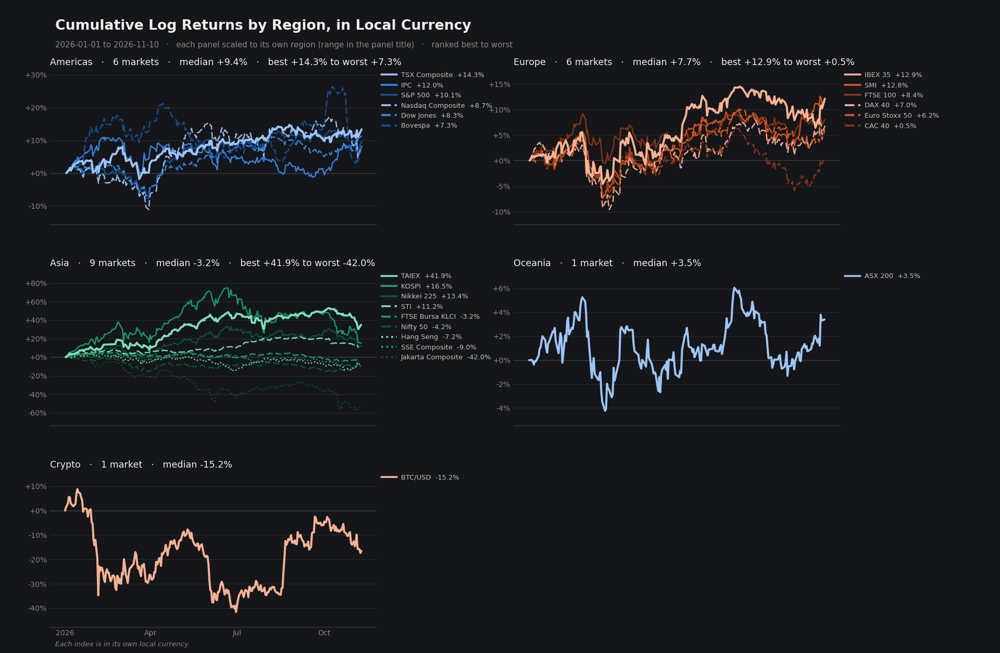
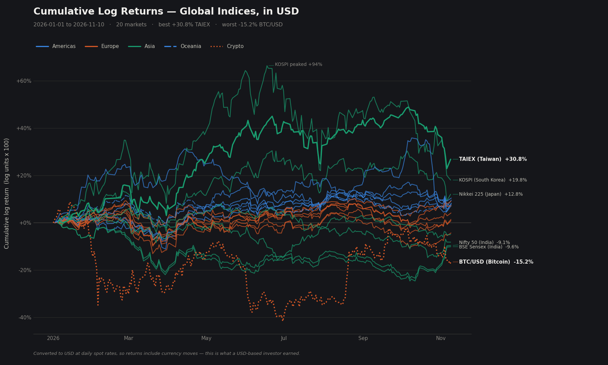
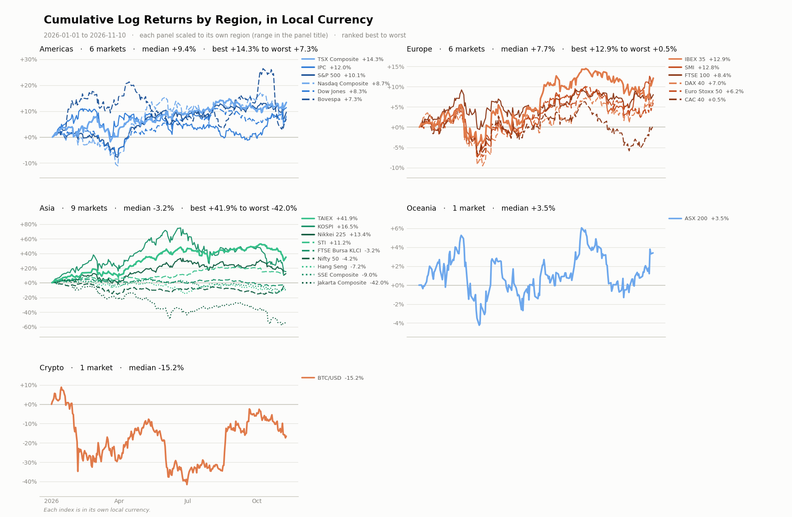
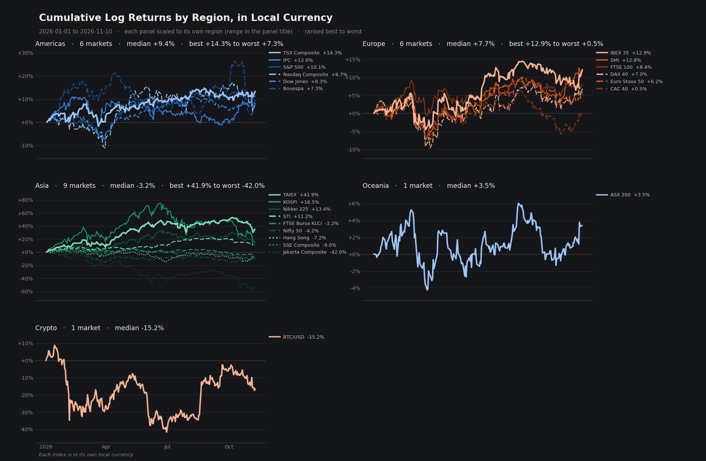

# Global Stock Indices — Log Return Visualizer

Compares the **cumulative log returns** of 23 major world equity indices, plus Bitcoin as a cross-asset benchmark — ranked best to worst, grouped by region, in local currency or converted to USD.

## Just run it

```bash
pip install -r requirements.txt
python index_comparison.py
```

No arguments needed. That gives you **year to date**, one panel per region with every index individually coloured, and the full ranked table printed to the terminal.



Every index gets its own shade and dash inside its region's colour, so you can match any curve to a name in the legend beside it. Each panel is scaled to its own region and prints its range in the title — one shared scale stretched to Asia's ±80% flattened the other regions into unreadable bands.

And the table, printed every run, all 23 markets best to worst:

```
  #  Market                         Region      In-rgn     Return       Vol      MaxDD   Ret/Vol   Bars
---  -----------------------------  ---------  -------  ---------  --------  ---------  --------  -----
  1  TAIEX (Taiwan)                 Asia          1/9*    +41.95%      30.3%    -20.31%     +1.38    204
  2  KOSPI (South Korea)            Asia           2/9    +16.46%      60.6%    -44.94%     +0.27    208
  3  TSX Composite (Canada)         Americas      1/6*    +14.31%      14.3%     -9.33%     +1.00    215
  ...
 23  Jakarta Composite (Indonesia)  Asia           9/9    -42.00%      31.4%    -46.31%     -1.34    204
```

### The three flags worth remembering

Everything else has a sensible default. These are the ones that change the answer:

```bash
python index_comparison.py --usd          # compare on one currency basis
python index_comparison.py --period 1y    # 1m, 3m, 6m, 1y, ytd
python index_comparison.py --region Asia  # just one region, full size
```

`python index_comparison.py --help` lists the rest.

---

## Why log returns

Log returns are **additive over time**, so a cumulative sum is a true compounded path rather than a sum of percentages that quietly overstates the result. They also make gains and losses symmetric: −50% and +100% are equal and opposite moves.

The chart plots the cumulative log return. The percentages in the labels and the table are converted back to simple returns with `exp(x) − 1`, because that is the number people actually recognise. The two diverge as magnitude grows — a log value of 0.35 is a +41.9% simple return — which is why the y-axis is labelled in log units and the callouts in percent.

### Two currency bases — and they disagree

By default every index is quoted in **its own local currency**, which measures local-market performance rather than the return earned by a single foreign investor.

Pass **`--usd`** to convert every index to USD at daily spot rates before computing returns. That answers the other question: *what did a USD-based investor actually earn?* The two rankings are genuinely different, because currency moves are part of the return:

| Market | Local | USD | Difference |
|---|---:|---:|---|
| TAIEX (Taiwan) | +41.9% | **+30.8%** | TWD fell — 11 points of the gain was currency |
| KOSPI (South Korea) | +16.5% | **+19.8%** | KRW rose, adding to the gain |
| SSE Composite (China) | −9.0% | **−4.8%** | CNY rose, cushioning the loss |
| Nifty 50 (India) | −4.2% | **−9.1%** | INR fell, deepening the loss |
| Jakarta (Indonesia) | −42.0% | **−45.4%** | IDR fell on top of an already bad year |
| S&P 500 (USA) | +10.1% | +10.1% | unchanged — already USD |

Conversion is applied to the **price level before returns are computed**, which is exact. Summing index returns and FX returns afterwards is only an approximation and drifts over long windows.

Both modes name their basis in the chart title, because the two are otherwise visually identical and mistaking one for the other misreads every number on the chart. `--currency-note` adds the matching caveat as a footnote.



---

## Design decisions

The light theme (`--theme light`), same default view:



Decisions that are doing real work:

- **Colour encodes region, not rank.** Lines are grouped Americas / Europe / Asia / Oceania / Crypto, so regional clustering is visible at a glance — that is the actual story in the data, and colouring by rank would have wasted the channel on information the y-position already carries.
- **Composite encoding — hue × line style.** Five regions is one class more than colour alone can carry safely. The three hues used are the only trio that clears the all-pairs colour-vision gate in both themes (worst-case CVD ΔE 9.4 dark / 9.2 light); adding a fourth or fifth hue drops some pair to ΔE ≈ 1.9, which is indistinguishable to a protanope. So the last two regions reuse hues and separate by dash pattern. **The encoding therefore survives colourblindness and black-and-white printing.**
- **Only the extremes are labelled on the combined chart.** With 23 markets on one axis, most finish within a few percent of each other; direct-labelling all of them produces a wall of text with crossing leader lines that cannot be traced back to a line. There the leaders and laggards get callouts (`--label-count N`) and the table carries the rest. The default per-region view labels every index, because a panel holds at most nine lines.
- **Within a panel, each index has its own shade *and* dash.** Two channels, not one: three lightness steps × three dash patterns gives nine distinct styles, enough for the largest region. A reader who can't separate the shades can still separate solid from dashed from dotted, so the encoding survives colourblindness and black-and-white printing. Every lightness ramp is validated as an ordinal scale against its own surface, not eyeballed.
- **Panels are scaled per region, with the range in the title.** A shared y-scale is the textbook choice for small multiples, and it was wrong here: stretched to Asia's +42%/−42% spread, the Americas and Europe collapsed into thin bands near zero and the within-region detail — the thing these panels exist to show — disappeared. Each panel now uses its full height and states its range, so comparison happens by reading rather than by eyeballing equal heights.
- **Legends sit beside their panel, not inside it.** Placing the key in whichever corner had the fewest points worked until a region had nine entries; Asia's panel then had no gap big enough. A reserved column cannot collide at all.
- **The peak is named.** The highest point on the chart draws the eye first. If it belongs to a line that ends far below it, the reader has no way to identify it — so it is annotated where it peaks.
- **Both themes are selected, not flipped.** The light and dark hues are separate steps validated against their own surface, not an automatic inversion.

---

## The other views

The default is per-region panels. Two alternatives:

### `--region`: drill into one

Charts a single region full-size, and because there are few enough lines, **every index gets its own end label**.

```bash
python index_comparison.py --region Asia
```

Repeatable and case-insensitive, so `--region asia --region europe` compares two regions head to head.

### `--combined`: all 23 on one axis

The original view. Best for seeing how whole regions move together rather than who leads within one — colour groups by region, and only the global leaders and laggards are labelled.



```bash
python index_comparison.py --combined
```

### The key table

Printed after every run. This is where "who is outperforming" actually gets answered, because raw return alone is misleading:

```
AMERICAS  (6 markets)
  #  Market                  Region      In-rgn     Return       Vol      MaxDD   Ret/Vol   Bars
---  ----------------------  ---------  -------  ---------  --------  ---------  --------  -----
  1  TSX Composite (Canada)  Americas      1/6*    +14.31%      14.3%     -9.33%     +1.00    215
  2  IPC (Mexico)            Americas       2/6    +12.03%      17.0%    -11.49%     +0.71    215
  3  S&P 500 (USA)           Americas       3/6    +10.08%      14.0%     -9.10%     +0.72    215
```

| Column | Meaning |
|---|---|
| **In-rgn** | Rank within its own region. `*` marks that region's leader. |
| **Return** | Total simple return over the window. |
| **Vol** | Annualised volatility — standard deviation of daily log returns × √252. |
| **MaxDD** | Worst peak-to-trough fall inside the window. |
| **Ret/Vol** | Return per unit of volatility. A crude risk-adjusted ranking, **not** a Sharpe ratio — there is no risk-free rate here. |
| **Bars** | Trading days actually fetched. Varies by holiday calendar. |

Two things this surfaces that the ranking hides:

- **KOSPI's +16.5% came with 60.6% volatility and a −44.9% drawdown** (Ret/Vol 0.27). TSX earned a similar +14.3% at 14.3% vol (Ret/Vol 1.00). Same ballpark return, very different ride.
- **Within Europe, IBEX edges SMI on return** (+12.86% vs +12.82%) but SMI did it at 12.8% vol against IBEX's 17.6%.

In the default view a one-line pecking order per region also prints, for reading a single region without scanning all 23 rows:

```
Americas  TSX Composite +14.3%  >  IPC +12.0%  >  S&P 500 +10.1%  >  Nasdaq Composite +8.7%  >  ...
Europe    IBEX 35 +12.9%  >  SMI +12.8%  >  FTSE 100 +8.4%  >  DAX 40 +7.0%  >  ...
```

And a region summary always prints last:

```
REGION      Markets     Median       Best  Leader
----------  -------  ---------  ---------  ----------------------------
Americas          6     +9.38%    +14.31%  TSX Composite (Canada)
Europe            6     +7.70%    +12.86%  IBEX 35 (Spain)
Oceania           1     +3.46%     +3.46%  ASX 200 (Australia)
Asia              9     -3.18%    +41.95%  TAIEX (Taiwan)
Crypto            1    -15.22%    -15.22%  BTC/USD (Bitcoin)
```

Sorted by median, which answers the regional question properly: **the Americas lead on median (+9.38%) even though Asia holds the single best market.** Asia's median is negative — one star and a long tail of losers.

---

## Install

```bash
pip install -r requirements.txt
```

Requires Python 3.9+ (builtin generic annotations). Verified on 3.10.

## All the options

You don't need these to use it — `python index_comparison.py` is the intended entry point. This is the reference.

| Flag | Description |
|---|---|
| `--period {1m,3m,6m,1y,ytd}` | Window relative to `--end`. Default `ytd`. |
| `--start YYYY-MM-DD` | Exact start date. Overrides `--period`. |
| `--end YYYY-MM-DD` | End date. Defaults to today. |
| `--usd` | Convert every index to USD at daily spot rates before computing returns. |
| `--region NAME` | Chart only this region. Repeatable, case-insensitive. |
| `--combined` | All markets on one axis instead of per-region panels. |
| `--theme {dark,light}` | Default `dark`. |
| `--out PATH` | Save the chart to this path. |
| `--no-show` | Don't open a window (switches to the Agg backend). Use on a server or in CI. |
| `--currency-note` | Stamp the currency-basis caveat on the figure. |
| `--title TEXT` | Override the chart title. |
| `--label-count N` | With `--combined`, direct-label the top and bottom N markets. Default 3; `0` draws none. |
| `--no-table` | Skip the printed table. |
| `--quiet` | Suppress per-ticker progress output. |

The screenshots above are reproducible:

```bash
python index_comparison.py --period ytd --end 2026-11-10 --out assets/chart-by-region.png --no-show --currency-note
```

```bash
python index_comparison.py --period ytd --end 2026-11-10 --combined --out assets/chart-dark.png --no-show --currency-note
```

```bash
python index_comparison.py --period ytd --end 2026-11-10 --combined --usd --out assets/chart-usd-dark.png --no-show --currency-note
```

---

## Markets covered

Tickers with the currency each is quoted in. Every currency was confirmed against the `currency` field Yahoo reports for that ticker, not assumed from the country.

| Region | Markets |
|---|---|
| **Americas** | S&P 500 `^GSPC` *USD* · Nasdaq Composite `^IXIC` *USD* · Dow Jones `^DJI` *USD* · TSX Composite `^GSPTSE` *CAD* · Bovespa `^BVSP` *BRL* · IPC Mexico `^MXX` *MXN* |
| **Europe** | DAX 40 `^GDAXI` *EUR* · FTSE 100 `^FTSE` *GBP* · CAC 40 `^FCHI` *EUR* · Euro Stoxx 50 `^STOXX50E` *EUR* · SMI `^SSMI` *CHF* · IBEX 35 `^IBEX` *EUR* |
| **Asia** | Nifty 50 `^NSEI` *INR* · Hang Seng `^HSI` *HKD* · SSE Composite `000001.SS` *CNY* · Nikkei 225 `^N225` *JPY* · KOSPI `^KS11` *KRW* · TAIEX `^TWII` *TWD* · Jakarta Composite `^JKSE` *IDR* · STI `^STI` *SGD* · FTSE Bursa KLCI `^KLSE` *MYR* |
| **Oceania** | ASX 200 `^AXJO` *AUD* |
| **Crypto** | BTC/USD `BTC-USD` *USD* |

### Deliberately excluded

Two tickers are commented out in the source rather than deleted, with the reason recorded:

- **MOEX Index (Russia)** `IMOEX.ME` — Yahoo Finance stopped serving this after the 2022 sanctions.
- **Tadawul All Shares (Saudi Arabia)** `^TASI.SR` — same symptom; returns zero rows for every window tested.

Both return *"possibly delisted; no price data found"* and would otherwise fail silently into the failure list on every run. Re-enabling either needs a different data source (the MOEX ISS API, or the Tadawul site), not `yfinance`.

---

## How it works

1. **Fetch** — each ticker's daily history via `yfinance`, with `auto_adjust=True` so splits and dividends don't appear as fake jumps.
2. **Convert** *(only with `--usd`)* — multiply the price level by that currency's `XXXUSD=X` daily rate. FX and equity calendars differ, so rates are reindexed onto the index's own trading days and carried forward; a leading gap is dropped rather than back-filled, so a rate is never invented before the first quote.
3. **Compute** — `log(Pₜ / Pₜ₋₁)`, anchored at 0 on the first day, then cumulatively summed.
4. **Rank** — sorted by final cumulative return.
5. **Render** — region-encoded lines, selective callouts, and a ranked table.

Failures are collected and reported at the end with a reason (`no price data` vs. an exception type) rather than being swallowed, so a dead ticker is visible instead of silently missing.

---

## Notes

- Data is sourced from Yahoo Finance and is **not** survivorship-bias free or guaranteed accurate. Don't trade on it.
- Markets have different holiday calendars, so the number of bars per index varies slightly over the same window. Each series is plotted against its own trading dates.
- `--usd` uses spot rates only. It does not model hedging costs, and it ignores the interest-rate differential a hedged investor would actually earn or pay.
- If an FX rate can't be fetched, that index is dropped with the reason rather than silently falling back to local currency, so a USD chart never mixes bases.
- `--no-show` switches matplotlib to the `Agg` backend, so it works headless.
